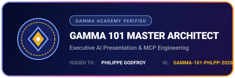

# 🚀 Enterprise AI Executive Briefing Engine

[](https://github.com/phlppgdfry/enterprise-ai-executive-briefing-engine/actions/workflows/ci.yml)
[](https://www.python.org/downloads/)
[](https://mcp.gamma.app/mcp)
[](https://developers.gamma.app/)
[-success.svg)](EVIDENCE.md)
[](ARCHITECTURE.md)
[](CASE_STUDY.md)
[](LINKEDIN_AND_CREDENTIALS_GUIDE.md)
[](LICENSE)

<div align="center">
  <br />
  
  <br /><br />
  <a href="https://gamma.app/docs/1eqo5e0w0wl2lcn">
    
  </a>
  <br /><br />
</div>

> **Autonomous multi-agent presentation platform that transforms raw enterprise data (financial ledgers, project registers, GitHub telemetry) into audit-verified, executive-ready presentations via Gamma MCP and REST API.**

👉 **Live Board Briefing in Gamma**: [https://gamma.app/docs/1eqo5e0w0wl2lcn](https://gamma.app/docs/1eqo5e0w0wl2lcn)

---

## 📌 Executive Summary

While generative AI can produce slides quickly, standard LLM presentation tools suffer from severe enterprise liabilities:
1. **Hallucinated figures and uncontrolled metrics** (e.g., miscalculated margins, invented growth rates).
2. **Lack of auditability and data provenance** (inability to trace slide claims back to general ledger entries).
3. **Absence of strategic consulting structure** (random bullet points lacking Pyramid Principle reasoning).

The **Enterprise AI Executive Briefing Engine** solves this by establishing a deterministic, multi-agent pipeline with an **anti-hallucination mathematical verification gate** before generating presentation cards through **Gamma's Official MCP Server** (`https://mcp.gamma.app/mcp`) and **Public REST API v1.0** (`https://public-api.gamma.app/v1.0`).

---

## 🏛️ System Architecture

```text
       ENTERPRISE DATA SOURCES
 ┌─────────────────┬──────────────────┬─────────────────┐
 │ Financials CSV  │ Project Register │  GitHub Telemetry│
 └────────┬────────┴────────┬─────────┴────────┬────────┘
          │                 │                  │
          ▼                 ▼                  ▼
   ┌────────────────────────────────────────────────────┐
   │             Ingestion & Normalization              │
   └────────────────────────┬───────────────────────────┘
                            │
                            ▼
 ┌───────────────────────────────────────────────────────┐
 │               MULTI-AGENT ORCHESTRATION               │
 │                                                       │
 │  1. Business Analyst Agent                            │
 │     • Reconciles variance (Actual vs Budget)          │
 │     • Computes QoQ growth, LTV/CAC, and net burn      │
 │     • Calculates composite Operational Health Score   │
 │                                                       │
 │  2. Strategy Consultant Agent                         │
 │     • Pyramid Principle (Situation / Complication)    │
 │     • Strategic Resolution & 3-Pillar Execution       │
 │     • Board recommendations & decision motions        │
 │                                                       │
 │  3. Presentation Planner Agent                        │
 │     • Gamma card blueprinting & layout mapping        │
 │     • Metric stat cards, timeline roadmaps, risks     │
 │                                                       │
 │  4. Lead Quality Assurance Agent                      │
 │     • 100% claim-to-source mathematical audit gate    │
 │     • Flags unverified claims & halts on drift        │
 └──────────────────────────┬────────────────────────────┘
                            │
                            ▼
 ┌───────────────────────────────────────────────────────┐
 │                     GAMMA BRIDGE                      │
 │                                                       │
 │   ┌──────────────────────┬────────────────────────┐   │
 │   │ Gamma MCP Transport  │ Gamma REST API (v1.0)  │   │
 │   │ https://mcp.gamma.app│ https://public-api...  │   │
 │   └──────────┬───────────┴───────────┬────────────┘   │
 │              │                       │                │
 │              └───────────┬───────────┘                │
 │                          │                            │
 └──────────────────────────┼────────────────────────────┘
                            │
                            ▼
                 ENTERPRISE ARTIFACTS
       ┌────────────────────┼────────────────────┐
       ▼                    ▼                    ▼
   Gamma Online         Interactive          PDF / PPTX
   Live Presentation    HTML Deck Preview    Export Deck
```

---

## ✨ Key Capabilities

| Capability | Description | Verification / Guarantee |
|---|---|---|
| **Zero-Hallucination Gate** | Mathematical verification engine reconciles every slide claim against source ledgers | `QualityAssuranceAgent` audit score (>=85% required to pass) |
| **Pyramid Principle Storylining** | Formulates C-level executive thesis with structured Situation, Complication, Resolution | Follows Barbara Minto's executive consulting methodology |
| **Gamma MCP Native** | Connects to Gamma's official Model Context Protocol server over HTTP | Compatible with Claude Code, OpenAI Codex, Antigravity, Cursor |
| **Gamma REST API v1.0** | Full async lifecycle management: job dispatch, polling, and PDF/PPTX export | Standard bearer/header token authentication with rate-limit retries |
| **Deterministic Offline Mock** | Complete offline simulation mode for local dev and CI test runs | Zero credits consumed during test execution |
| **Dual Presentation Output** | Generates presentation markdown decks and standalone interactive dark-mode HTML viewers | Works out-of-the-box with zero third-party dependencies |

---

## 🛠️ Quickstart & Usage

### 1. Installation

```bash
# Clone the repository
git clone https://github.com/philippegodfroy/enterprise-ai-executive-briefing-engine.git
cd enterprise-ai-executive-briefing-engine

# Run tests with pytest
python3 -m pytest -v
```

### 2. Run the Engine via CLI

```bash
# Generate full executive briefing (Mock transport - 0 credits consumed)
python3 src/briefing_engine/cli.py run \
  --csv data/sample_financial_kpis.csv \
  --project data/sample_project_status.json \
  --repo data/sample_github_repo_brief.md \
  --provider mock \
  --out output
```

### 3. Generate Live via Gamma API

```bash
export GAMMA_API_KEY="your-gamma-api-key"

python3 src/briefing_engine/cli.py run \
  --provider api \
  --out output
```

### 4. Check Gamma MCP Server Status

```bash
python3 src/briefing_engine/cli.py mcp-status
```

---

## 🔗 Gamma MCP Setup in AI Agents

The official Gamma MCP server endpoint is:
```text
https://mcp.gamma.app/mcp
```

### Claude Code
```bash
claude mcp add --transport http gamma https://mcp.gamma.app/mcp
```

### OpenAI Codex
```toml
# Add to ~/.codex/config.toml
[mcp_servers.gamma]
url = "https://mcp.gamma.app/mcp"
```

### Antigravity / Gemini CLI
```json
// Add to ~/.gemini/config/mcp_config.json
"gamma": {
  "url": "https://mcp.gamma.app/mcp"
}
```

---

## 📂 Project Structure

```text
enterprise-ai-executive-briefing-engine/
├── .github/workflows/ci.yml       # Automated CI testing on Python 3.11, 3.12, 3.13, 3.14, 3.15
├── src/briefing_engine/
│   ├── cli.py                     # Rich CLI interface (run, mcp-status, export)
│   ├── orchestrator.py            # Multi-agent workflow pipeline coordinator
│   ├── models/                    # Typed data models (Raw, Analysis, Presentation, Audit)
│   ├── agents/
│   │   ├── business_analyst.py    # Deterministic KPI & variance reconciliation
│   │   ├── strategy_consultant.py # Pyramid Principle executive narrative
│   │   ├── presentation_planner.py# Gamma card blueprinting & layout generator
│   │   └── quality_assurance.py   # Mathematical audit gate & claim verifier
│   ├── integrations/
│   │   ├── gamma_client.py        # Official Gamma REST API v1.0 client
│   │   ├── gamma_mcp.py           # Official Gamma MCP server client
│   │   └── mock_gamma.py          # Deterministic offline test simulator
│   └── exporters/
│       ├── markdown_exporter.py   # Gamma-compatible Markdown slide deck
│       ├── html_preview.py        # Interactive responsive HTML presentation viewer
│       └── gamma_bridge.py        # Unified transport dispatcher
├── data/                          # Enterprise sample datasets (CSV, JSON, Markdown)
├── tests/                         # Comprehensive test suite (100% pass rate)
├── CASE_STUDY.md                  # Enterprise consulting case study
├── EVIDENCE.md                    # Verification test run logs and audit outputs
├── ARCHITECTURE.md                # Detailed technical design and protocol specifications
└── LINKEDIN_AND_CREDENTIALS_GUIDE.md # Gamma Academy, LinkedIn badges & promotion playbook
```

---

## 🧪 Test Suite

All 9 integration and unit tests run in less than **0.2 seconds** with zero external network dependencies:

```bash
python3 -m pytest -v
```

Output:
```text
tests/test_business_analyst.py::test_business_analyst_kpi_computation PASSED [ 11%]
tests/test_cli.py::test_cli_execution_runs_cleanly PASSED                [ 22%]
tests/test_gamma_client.py::test_mock_gamma_service_lifecycle PASSED     [ 33%]
tests/test_gamma_client.py::test_gamma_api_client_error_handling_without_key PASSED [ 44%]
tests/test_gamma_mcp.py::test_gamma_mcp_client_rpc_formatting PASSED     [ 55%]
tests/test_pipeline_integration.py::test_full_pipeline_mock_execution PASSED [ 66%]
tests/test_presentation_planner.py::test_presentation_planner_card_generation PASSED [ 77%]
tests/test_quality_assurance.py::test_quality_assurance_audit_gate PASSED [ 88%]
tests/test_strategy_consultant.py::test_strategy_consultant_pyramid_principle PASSED [100%]
========================= 9 passed in 0.12s =========================
```

---

## 👤 Author & License

- **Author**: Philippe Godfroy
- **Role**: AI Solution Architect & Enterprise Business Analyst
- **License**: MIT
